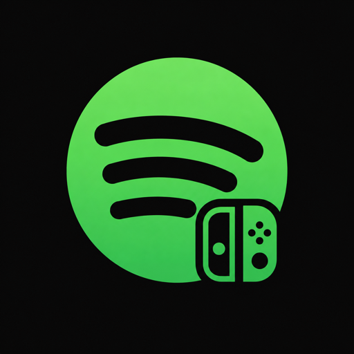

<p align="center"></p>

# iSpotifai

Homebrew for Nintendo Switch running CFW (Atmosphère). Two build targets:

- `app/` — client, builds `ispotifai.nro`, runs from the Homebrew Menu
- `overlay/` — Tesla overlay, builds `ispotifai.ovl`, runs on top of games
- `common/` — code shared by both

## Requirements

devkitPro with the `switch-dev` group:

```
sudo installer -pkg devkitpro-pacman-installer.pkg -target /
sudo dkp-pacman -S switch-dev
```

Then in your shell profile:

```
export DEVKITPRO=/opt/devkitpro
export DEVKITA64=$DEVKITPRO/devkitA64
export PATH=$DEVKITPRO/tools/bin:$PATH
```

On Apple Silicon the devkitPro binaries are x86_64 and run under Rosetta 2.
Alternative without a local install:

```
docker run --rm --platform linux/amd64 -v "$PWD":/app -w /app devkitpro/devkita64 make
```

## Build

```
make            # both targets, staged into dist/
make app
make overlay
```

## Deploy

The `.nro` goes to `/switch/ispotifai/` on the SD card, the `.ovl` to `/switch/.overlays/`.

```
make run     SWITCH_IP=192.168.1.x   # nxlink: pushes and runs the .nro, stdout back to the terminal
make install SWITCH_IP=192.168.1.x   # FTP upload of both files (needs ftpd running on the console)
```

The overlay also needs [nx-ovlloader](https://github.com/WerWolv/nx-ovlloader) and
[Tesla-Menu](https://github.com/WerWolv/Tesla-Menu) installed. Default open combo is
`L + DPad-Down + Right Stick`.

## Clone

```
git clone --recursive <url>     # libtesla is a submodule
```
